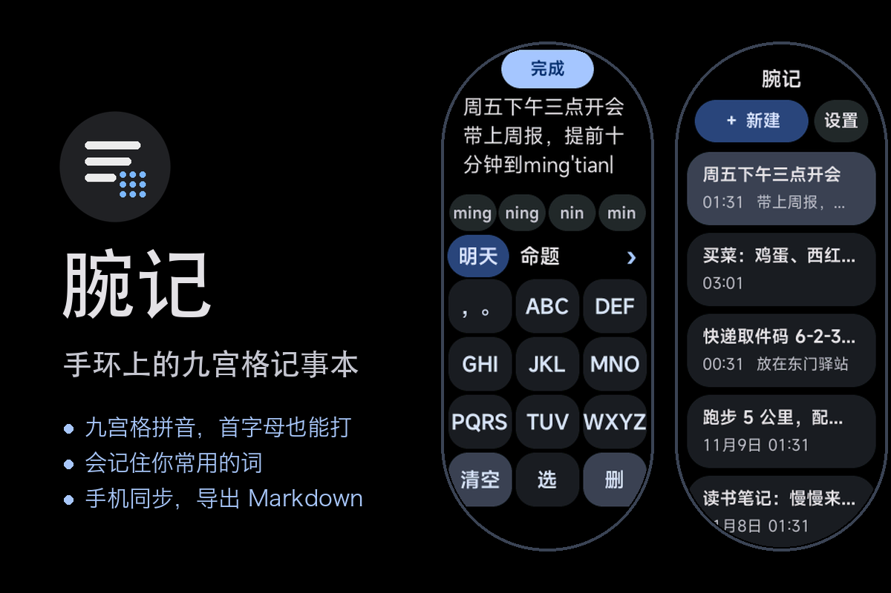
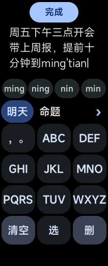
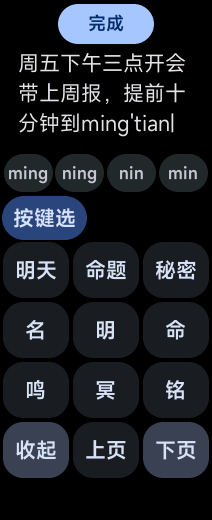
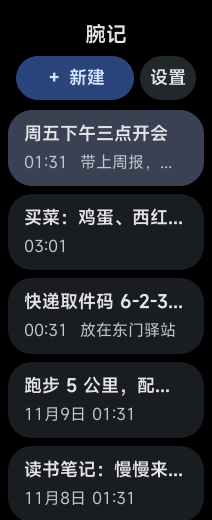
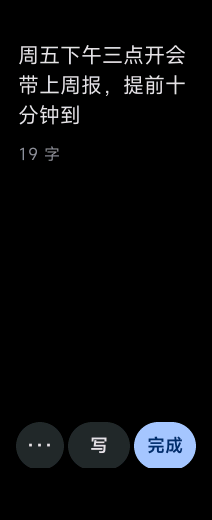
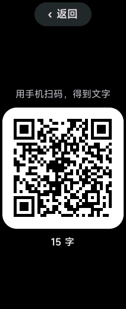
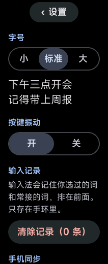

# 腕记

小米手环上能真正打字的记事本。

## 能做什么

- **九宫格拼音**：收了 2 万个常用词，只按首字母也能打（J T 就是「今天」）
- **会学习**：选过的词排在前面，还会记住你常接的下一个词
- **好改**：点文字挪光标，撤销重做，内容变了 3 秒自动保存
- **英文、数字、标点**，日期和时间一点就插入
- **导出**：二维码扫码带走；配合 AstroBox 插件「腕记同步」，能在手机上读取、复制、导出 Markdown，也能把手机上写好的文字发到手环
- **不联网**：记事只存在手环本机

## 适配

| 机型 | 屏幕 |
|---|---|
| 小米手环 9 | 192×490 胶囊屏 |
| 小米手环 10 / 10 NFC / 11 / 11 NFC | 212×520 胶囊屏 |
| 小米手环 9 Pro / 10 Pro | 336×480 矩形屏 |

同一个安装包，按屏幕形状自动换一套尺寸。

## 安装

在 AstroBox 的资源商店里搜「腕记」，或者下载本仓库里的 `.rpk`，用 AstroBox 打开安装。

## 截图

| 打字 | 展开候选 | 列表 |
|---|---|---|
|  |  |  |

| 阅读 | 二维码导出 | 设置 |
|---|---|---|
|  |  |  |

## 许可

词库来自 [pinyinjs](https://github.com/sxei/pinyinjs)、[jieba](https://github.com/fxsjy/jieba)、[phrase-pinyin-data](https://github.com/mozillazg/phrase-pinyin-data)，均为 MIT 许可，许可全文在安装包的 `common/legal` 目录。
